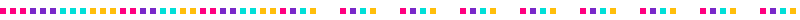

<div align="center">



[](https://git.io/typing-svg)

<p>
  
  
  
  
</p>

</div>

<div align="center"></div>

<div align="center">
  
  <h2>⚡ What is this?</h2>
  <p><b>Agentic-AI-Skills</b> is a curated vault of <b>22 plug-and-play AI agent skills</b> — <b>19</b> <code>.zip</code> packs, <b>1</b> <code>.skill</code> package and <b>2</b> already-unpacked folders.<br/>Pick a pack by name, unzip only what you need, and ship.</p>
</div>

<div align="center">

| 🚀 Pick | 📦 Unzip Only What You Need | 🤖 Build |
|:---:|:---:|:---:|
| Browse the vault below | `Expand-Archive "frontend-design.zip"` | Drop `SKILL.md` into your agent |

</div>

<div align="center"></div>

## 🌈 Animated Vault Map

> Every name below is the **exact filename or folder name** in this repo. Descriptions are inferred from those names — **no zip was extracted** to write this README.

<details open>
<summary> <b>DESIGN & FRONTEND — 7 packs</b></summary>
<br/>

| # | Pack | What it unlocks | Vibe |
|:-:|---|---|---|
| 1 | [`frontend-design.zip`](frontend-design.zip) | Landing pages, components, responsive UI |  |
| 2 | [`canvas-design.zip`](canvas-design.zip) | Canvas art, posters, visual experiments |  |
| 3 | [`UI-UX Desinger.zip`](UI-UX%20Desinger.zip) | UX flows, wireframes, designer agent *(filename spelled as in the repo)* |  |
| 4 | [`brand-guidelines.zip`](brand-guidelines.zip) | Logos, colors, typography, brand kits |  |
| 5 | [`theme-factory.zip`](theme-factory.zip) | Themes, dark/light modes, design tokens |  |
| 6 | [`Landing-page-contents.zip`](Landing-page-contents.zip) | Hero copy, CTAs, landing page content |  |
| 7 | [`graphic-designer.skill`](graphic-designer.skill) | Graphic designer agent (`.skill` package) |  |

</details>

<details open>
<summary> <b>ANIMATION & MOTION — 3 packs</b></summary>
<br/>

| # | Pack | What it unlocks | Vibe |
|:-:|---|---|---|
| 8 | [`animations.zip`](animations.zip) | Animation recipes — sprites, UI, transitions |  |
| 9 | [`hyperframes-animation.zip`](hyperframes-animation.zip) | Frame-by-frame / HyperFrames animation workflows |  |
| 10 | [`motion-graphics.zip`](motion-graphics.zip) | Motion graphics, animated titles, explainers |  |

</details>

<details open>
<summary> <b>DOCUMENTS & CONTENT — 3 packs</b></summary>
<br/>

| # | Pack | What it unlocks | Vibe |
|:-:|---|---|---|
| 11 | [`docx-design-agent.zip`](docx-design-agent.zip) | Styled Word documents |  |
| 12 | [`internal-comms.zip`](internal-comms.zip) | Announcements, memos, team updates |  |
| 13 | [`Claude Ats resume friendly resume.zip`](Claude%20Ats%20resume%20friendly%20resume.zip) | ATS-friendly resume builder |  |

</details>

<details open>
<summary> <b>CLAUDE & AGENT POWER — 6 packs</b></summary>
<br/>

| # | Pack | What it unlocks | Vibe |
|:-:|---|---|---|
| 14 | [`claude-api/`](claude-api/) | Claude API reference + live examples (python, typescript, go, java, php, ruby, csharp, curl) — **unpacked folder** |  |
| 15 | [`prompt-engineer.zip`](prompt-engineer.zip) | Prompt optimization & engineering |  |
| 16 | [`skill-creator.zip`](skill-creator.zip) | Scaffold new skills fast |  |
| 17 | [`Skill-creator-framework/`](Skill-creator-framework/) | `6-figure-framework-claude-SKILLS.md` playbook — **unpacked folder** |  |
| 18 | [`caveman.zip`](caveman.zip) | Caveman-style skill pack |  |
| 19 | [`Honest-Advisor.zip`](Honest-Advisor.zip) | No-fluff, brutally honest advisor |  |

</details>

<details open>
<summary> <b>BUILDER & WORKFLOW — 3 packs</b></summary>
<br/>

| # | Pack | What it unlocks | Vibe |
|:-:|---|---|---|
| 20 | [`mcp-builder.zip`](mcp-builder.zip) | Build MCP servers & tools |  |
| 21 | [`webapp-testing.zip`](webapp-testing.zip) | Webapp QA & test flows |  |
| 22 | [`find-skills.zip`](find-skills.zip) | Discover & index skills |  |

</details>

<div align="center"></div>

<div align="center">
<h2>🎬 Animated Quick Start</h2>

</div>

```powershell
# 1 — See what's in the vault (no extraction)
Get-ChildItem *.zip, *.skill | Sort-Object Name

# 2 — Unzip ONLY what you need (examples)
Expand-Archive "frontend-design.zip" -DestinationPath "./_active/frontend-design"
Expand-Archive "mcp-builder.zip"     -DestinationPath "./_active/mcp-builder"
Expand-Archive "UI-UX Desinger.zip"  -DestinationPath "./_active/ui-ux-designer"   # quote names with spaces

# 3 — Use it
# Open _active/<pack>/SKILL.md and follow the instructions
# claude-api/ and Skill-creator-framework/ are already unpacked — just browse them
```

```bash
# macOS / Linux equivalent
ls *.zip *.skill
unzip "frontend-design.zip" -d ./_active/frontend-design
```

> ⚠️ **Rule:** this README was built from **filenames only** — no zip was extracted. Keep it that way until you need a skill.

<div align="center"></div>

<div align="center">
<h2>🗂️ Repo Layout</h2>
</div>

```
Agentic-AI-Skills/
├── README.md                                   ← you are here ✨
├── assets/                                     ← pixel-art animations used by this README (SVG)
│
├── 🎨 Design & Frontend
│   ├── frontend-design.zip
│   ├── canvas-design.zip
│   ├── UI-UX Desinger.zip
│   ├── brand-guidelines.zip
│   ├── theme-factory.zip
│   ├── Landing-page-contents.zip
│   └── graphic-designer.skill
│
├── 🎬 Animation & Motion
│   ├── animations.zip
│   ├── hyperframes-animation.zip
│   └── motion-graphics.zip
│
├── 📄 Documents & Content
│   ├── docx-design-agent.zip
│   ├── internal-comms.zip
│   └── Claude Ats resume friendly resume.zip
│
├── 🤖 Claude & Agent Power
│   ├── claude-api/                             ← unpacked (csharp, curl, go, java, php, python, ruby, shared, typescript)
│   ├── Skill-creator-framework/                ← unpacked
│   │   └── 6-figure-framework-claude-SKILLS.md
│   ├── prompt-engineer.zip
│   ├── skill-creator.zip
│   ├── caveman.zip
│   └── Honest-Advisor.zip
│
└── 🧰 Builder & Workflow
    ├── mcp-builder.zip
    ├── webapp-testing.zip
    └── find-skills.zip
```

<div align="center"></div>

<div align="center">
<h2>💡 Pro Tips</h2>
</div>

| Tip | How |
|---|---|
| 🔍 Preview before unzip | `tar -tf "mcp-builder.zip"` / `unzip -l "mcp-builder.zip"` |
| 🧪 Try one skill at a time | Unzip into `./_active/<name>` and delete when done |
| 🧬 Create your own | Unzip `skill-creator.zip`, read its `SKILL.md` |
| 🛰️ Claude API fast path | Skip the zips — browse `./claude-api/` directly |
| 🏗️ MCP fast path | `Expand-Archive "mcp-builder.zip"` |
| 🎬 Animation fast path | Start with `animations.zip`, then `motion-graphics.zip` |

<div align="center"></div>

<div align="center">
<h2>🤝 Contribute</h2>
<p>Add a new <code>.zip</code> → add one row to the vault map above (and bump the counts) → PR. That's it.</p>
</div>

<div align="center">



<p>
  
  
</p>

⭐ Star this repo if a skill saved you an hour ⭐

</div>
